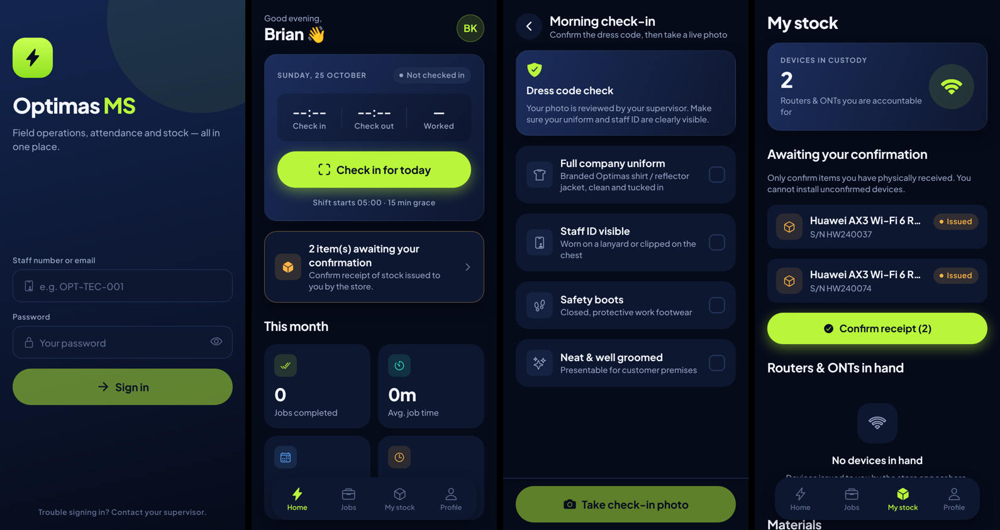
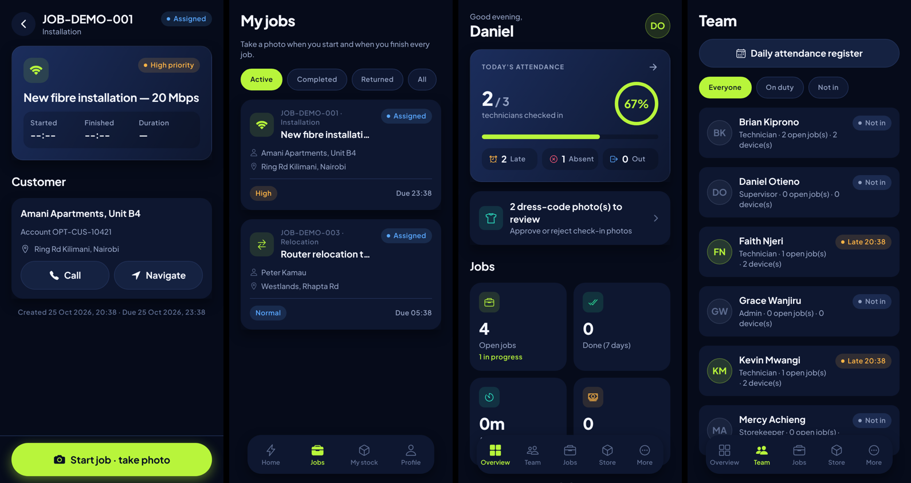
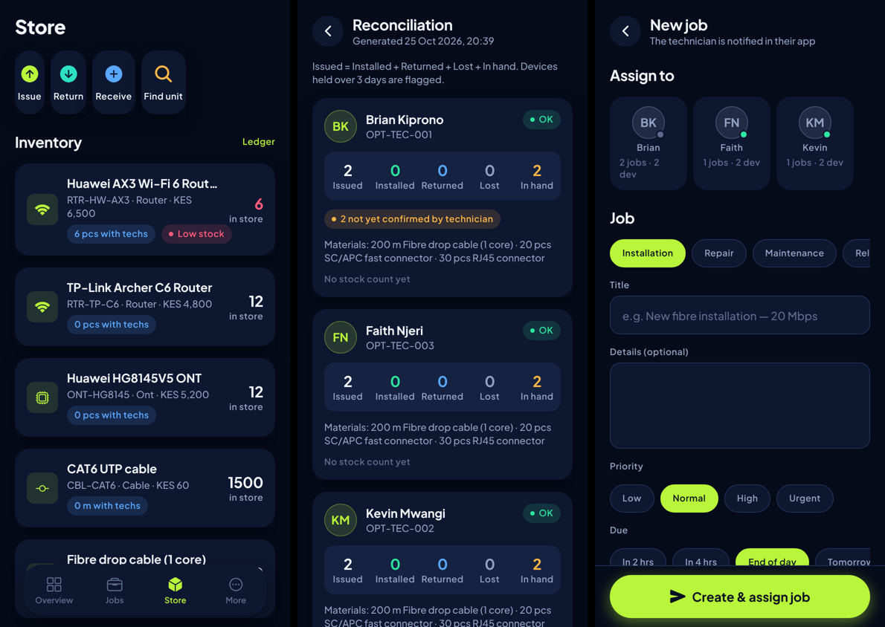

# Optimas MS

**Field workforce, attendance and inventory management for Optimas (internet service provider).**

Optimas MS gives management a digital, auditable view of every field employee: who reported to work and
when (with a dress-code photo), what job they are on, how long it took (with before/after proof photos),
what materials they used — and, crucially, **where every router is at all times**.

| Technician app | Jobs & supervisor overview | Store & reconciliation |
|---|---|---|
|  |  |  |

---

## Features

### 👷 Technician app
- **Morning check-in** — dress-code checklist (uniform, ID, boots, grooming) + live selfie + GPS. Late arrivals marked automatically.
- **Evening check-out** — live selfie, hours worked, and a list of every device/material still in their custody.
- **Jobs** — assigned jobs with customer, call & navigate buttons.
  - **Start job** → live "before" photo (start time recorded).
  - **Complete job** → scan installed router serial(s), enter materials & quantities (value auto-calculated), amount collected, notes → live "after" photo. Duration is computed by the server.
- **My stock** — confirm receipt of issued devices, see days held, run a scan-based **stock count**.
- **Camera only** — there is no gallery picker anywhere. Photos are bound to single-use, 90-second server challenges and duplicate images are rejected.

### 🧑‍💼 Supervisor / storekeeper console
- **Overview dashboard** — attendance %, late/absent, jobs open / awaiting verification, average job time, cash collected, router flow (store → technicians → installed) and risk alerts.
- **Team** — live on-duty status, open jobs and devices held per person; **daily attendance register** with absentees and photo flags.
- **Dress-code reviews** — approve / reject each check-in photo.
- **Jobs** — create & assign, verify or reject completed work after reviewing proof photos and materials.
- **Store** — receive (by serial scan), issue, accept returns (good / faulty), low-stock alerts, full **stock ledger**.
- **Reconciliation** — per technician: Issued = Installed + Returned + Lost + In hand; overdue devices; last stock-count discrepancies.
- **Trace a device** — complete chain of custody for any serial number; report lost.

### 🔐 How the router-accountability problem is solved
1. Every router/ONT is registered by **serial number** on arrival.
2. Issuing requires the **technician to confirm receipt** in-app (two-party handover).
3. A router can only leave a technician's custody by being **scanned at a customer on a completed job** (with photo + account number) or **returned to the store**.
4. **Custody cap** (default 5) and **ageing alerts** (default 3 days) stop stockpiling.
5. **Spot stock counts** expose missing devices immediately.
6. All movements are written to an **immutable ledger**.

See [docs/ARCHITECTURE.md](docs/ARCHITECTURE.md) for the full design.

---

## Repository layout

```
OPTIMAS-MS/
├── backend/   Node.js + Express + TypeScript + Prisma (PostgreSQL) REST API
├── mobile/    Expo (React Native) app — technician & supervisor experiences
├── docs/      Architecture, API reference, roadmap, screenshots
└── docker-compose.yml
```

## Quick start

### Prerequisites
- Node.js 20+
- PostgreSQL 16 (or Docker)
- Expo Go app on an Android/iOS phone (or an emulator)

### 1. Database
```bash
docker compose up -d db
```

### 2. API
```bash
cd backend
cp .env.example .env          # set JWT_SECRET, office coordinates, shift start…
npm install
npx prisma migrate deploy     # create tables
npm run db:seed               # demo users, stock and jobs
npm run dev                   # http://localhost:4000/api/v1
```

### 3. Mobile app
```bash
cd mobile
npm install
cp .env.example .env          # EXPO_PUBLIC_API_URL=http://<your-computer-LAN-IP>:4000/api/v1
npx expo start                # scan the QR code with Expo Go
```

### Demo accounts (password `Optimas@2026`)

| Staff no. | Role | Name |
|---|---|---|
| `OPT-ADM-001` | Admin | Grace Wanjiru |
| `OPT-SUP-001` | Supervisor | Daniel Otieno |
| `OPT-STR-001` | Storekeeper | Mercy Achieng |
| `OPT-TEC-001` | Technician | Brian Kiprono |
| `OPT-TEC-002` | Technician | Kevin Mwangi |
| `OPT-TEC-003` | Technician | Faith Njeri |

## Configuration (backend `.env`)

| Variable | Default | Purpose |
|---|---|---|
| `SHIFT_START` | `08:00` | Start of the working day (company local time) |
| `LATE_GRACE_MINUTES` | `15` | Check-ins after start + grace are marked **late** |
| `TZ_OFFSET_MINUTES` | `180` | Company time zone offset (Nairobi = UTC+3) |
| `CAPTURE_TTL_SECONDS` | `90` | How long a photo challenge is valid |
| `OFFICE_LAT` / `OFFICE_LNG` / `OFFICE_RADIUS_M` | Nairobi CBD / 300 | Check-in geofence (flags `OUTSIDE_GEOFENCE`) |
| `MAX_ROUTERS_IN_CUSTODY` | `5` | Max un-installed routers/ONTs a technician may hold |
| `CUSTODY_AGE_ALERT_DAYS` | `3` | Devices held longer are flagged |

## Building the app for staff phones
```bash
cd mobile
npm install -g eas-cli
eas build -p android --profile preview   # produces an installable APK
```

## Documentation
- [Architecture & design](docs/ARCHITECTURE.md)
- [API reference](docs/API.md)
- [Roadmap](docs/ROADMAP.md)
